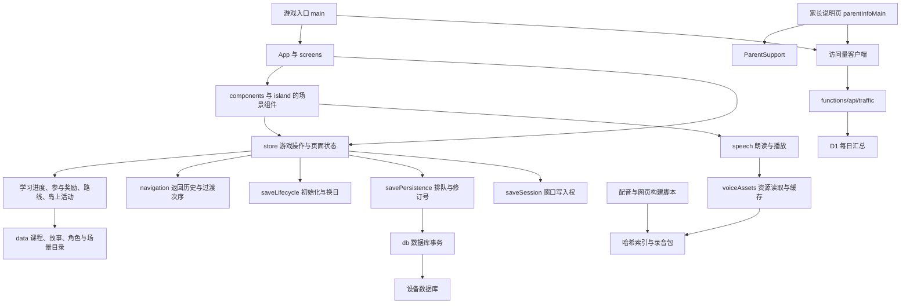

# 架构与决策

## 入口与依赖

`npm run --silent architecture -- --dot` 输出应用与服务端 TypeScript 模块的逐文件运行时依赖图，含静态导入、再导出和使用固定路径的动态导入。类型关系交给 TypeScript 检查。下图标出业务协作关系，箭头指向被使用的一方。

## 状态与修改位置

| 业务或技术边界 | 权威位置与调用约定 |
| --- | --- |
| 页面、临时弹层 | App 和页面组件负责显示。页面通过 store 的 go/back 调用 navigation，后者保留可返回的浏览页，切换存档会重置足迹。单次练习和录音的临时状态归当前组件。 |
| 学习、奖励与小岛 | curriculum 定义课程与顺序，learningProgress 维护学习记录，learningPath 计算路线，participation 结算每日参与。island/world 定义地点，plays、errands、parties 各负责一种活动。store 组合动作并决定何时持久化。 |
| 本地数据 | types 定义存档契约，saveValidation 校验外部数据、在副本上迁移历史字段。saveLifecycle 负责初始化和换日，savePersistence 串行写入，db 拥有表结构、修订号校验和导入前备份。儿童日记和跟读录音是独立数据表。 |
| 语音与媒体 | voiceKey 定义台词键，speech 调度播放，voiceAssets 读取本地清单或发布包。scripts/voice 与 scripts/art 生产媒体。运行时录音与合成素材分开管理。 |
| 界面与视觉 | screens 组织页面，components 复用操作、导航、图标和无障碍行为。brand-tokens.css 定义品牌变量。图像位置来自 sceneLayers.generated.json，二维与立体渲染共用布局。样式欠账由既有样式测试限定。 |
| 设备能力 | lib/mic、clipRecorder、native、network 处理设备生命周期。绘本临时回放、练习留档、小日记原声有不同保留契约。 |
| 配置、更新与缓存 | vite.config.ts 组装入口、构建变量与缓存。scripts/online 管分片、网站清单、请求头和产物验证。onlineUpdate 管网页换版，offlineUpdate 服务离线包。安卓及离线包保留原发布入口。 |
| 错误与恢复 | SaveRecovery 处理读取、写入、冲突与重试。网络统计失败可丢弃，媒体读取失败允许下次点击重试。它们需要各自的失败语义。 |
| 访问控制与统计 | 家长入口由 ParentGate 负责。访问量接口校验来源、格式、限额与隐私信号。analyticsPolicy、trafficPolicy、interactionPolicy 限定可发送内容。家长授权、退出选择和儿童数据各有独立用途。 |
| 工具与验收 | scripts/tests 自动发现用例。check:source 用源码跑依赖、类型、静态检查和全部无需媒体的测试。check 还运行全部媒体用例。网页构建走 scripts/online/build.mjs，发布另行执行。 |

## 决策记录

1. 用 TypeScript 已有的模块解析和转译结果检查运行时循环。纯类型互引会在编译时消失，无需为它搬迁领域类型。家长公开页、接口、存档校验和内容目录到游戏服务的间接依赖也纳入检查。
2. 保留纯源码检查与完整媒体检查两个入口。新拉取源码可在合并前验证核心规则；持有媒体的工作树运行完整构建验证。

3. 配音分片是已发布格式。用带类型注释的普通 JavaScript 让原生 Node 工具和浏览器直接导入同一实现。固定样例锁住旧编号，最终产物校验逐条核对录音原始字节。

4. 存档副本、内存状态和磁盘提交有不同的成功时点。saveLifecycle 管理副本上的领域迁移，SavePersistence 管理一扇窗口的写入顺序和已知修订号，db 通过单个事务检查磁盘修订号。存档冲突按用户选择重读；正常重读会先写完排队的修改。

5. 四个入口共用 guidedPath 组装学习路线。奖励结算仍读固定站点，首次见面和待复习站点只影响当前导航。练习目录保留两种有意义的顺序，存档沿用原任务板顺序，菜单按孩子看到的顺序排列。
6. 页面继续从 store 调用游戏操作。返回历史、时钟、存档和学习路线各自持有规则。新增事件总线或为每个动作设置转发模块都会增加查找一次操作的成本。领域入口的间接依赖由 architecture 检查；页面过渡由 store 传入导航模块。
7. 日记备份的导出顺序与孩子查看日记的顺序各有调用方。db 在同一事务内判重并写入，调用方指定所需顺序。访问统计为可丢弃的计数，儿童学习存档需要可重试的持久写入，两者保留独立的失败处理。

## 开发与发布边界

| 范围 | 输入、输出与所有权 |
| --- | --- |
| 网页应用 | React 显示页面，Zustand 组合用户动作，Dexie 管理浏览器本地数据。家长说明入口可单独加载。storyPreviewMain 用于绘本预览。 |
| 配音、美术、环境与音乐 | scripts/voice、art、environment、music 及切图工具负责生成本地素材。构建从 public 读取已有媒体，分片编号作为发布契约。素材和家庭数据不进入源码仓库。 |
| 网页发布 | scripts/online/build 依次检查源码、归档、生成网页和校验产物。release-prepare 与 publish 是独立操作。旧标签页使用上一版本的带哈希资源，更新和恢复页另有访问契约。 |
| 网站接口 | functions/api/traffic 接收允许的页面计数，migrations 定义汇总表，scripts/online/traffic-report 读取汇总。统计遵守退出设置和隐私信号，数据库异常只返回状态码。客服配置集中在 supportChatClient，不参与儿童存档。 |
| 本地与设备 | Vite 开发和预览服务及本地设备服务接入 scripts/mobile 的日记转写接口，要求同源请求。浏览器的麦克风授权与进入家长区的操作分别管理。android 与 Capacitor 保留设备打包契约，当前发布入口是网页。 |
| 验收与历史 | scripts/tests 承担可重复测试，scripts/dev 使用合成存档，docs 下的发布记录和历史设计按时间保留。源码检查可独立执行，配音校验、浏览器音频和网页发布构建需要本地完整媒体。 |
